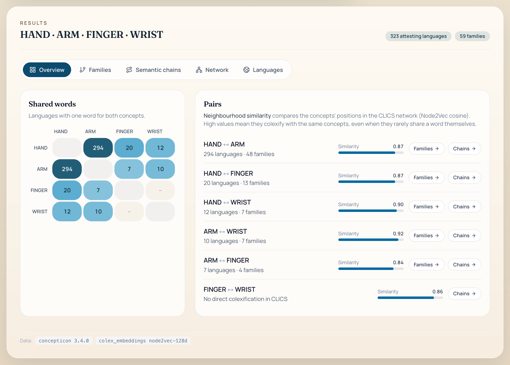
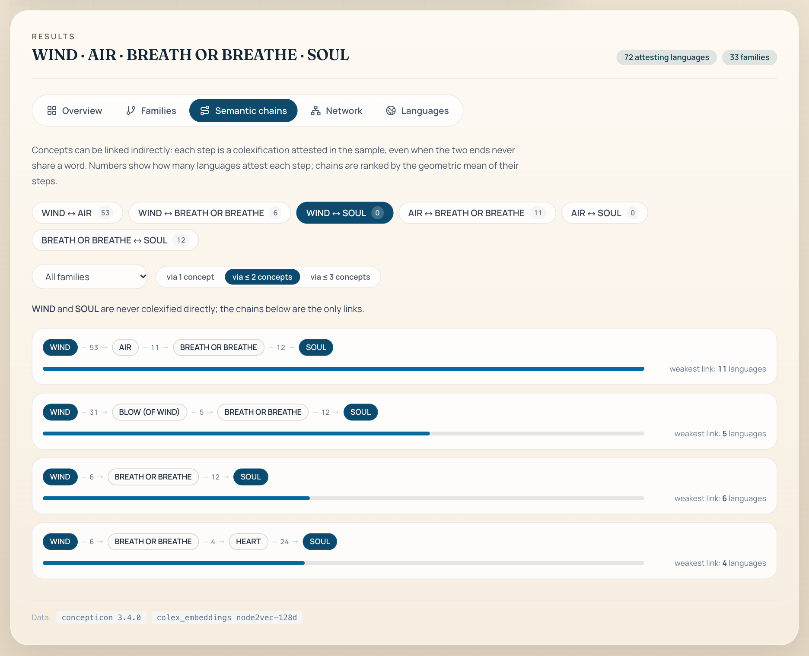
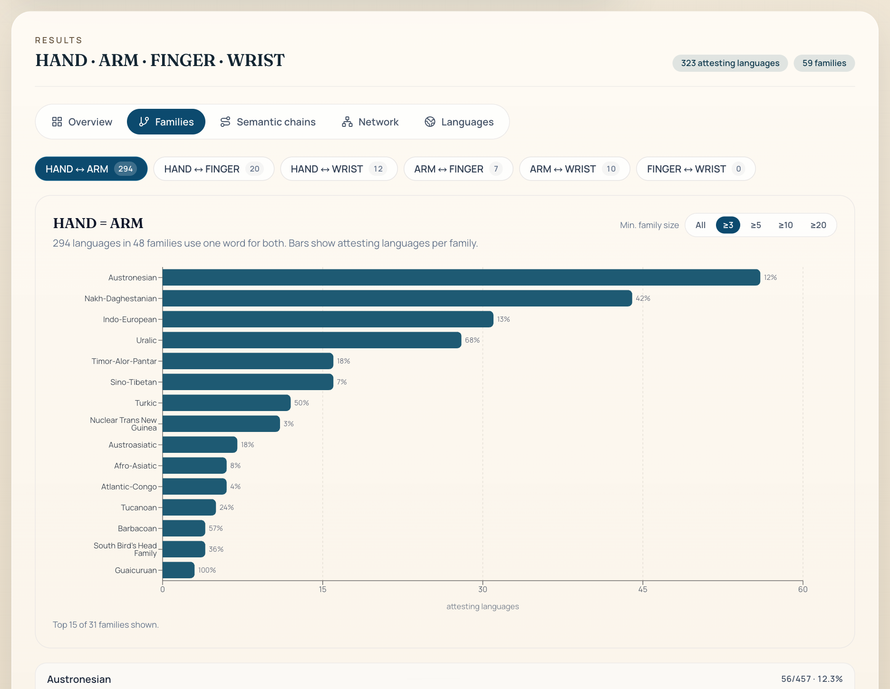
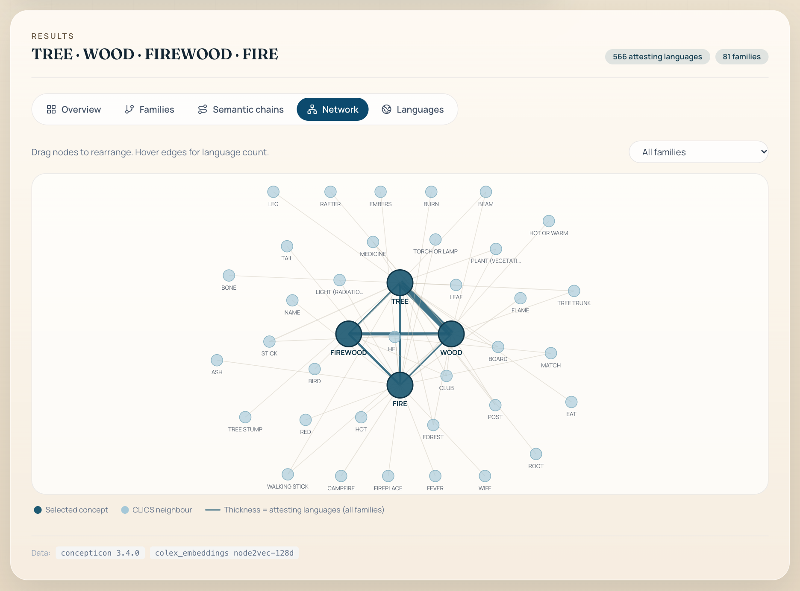
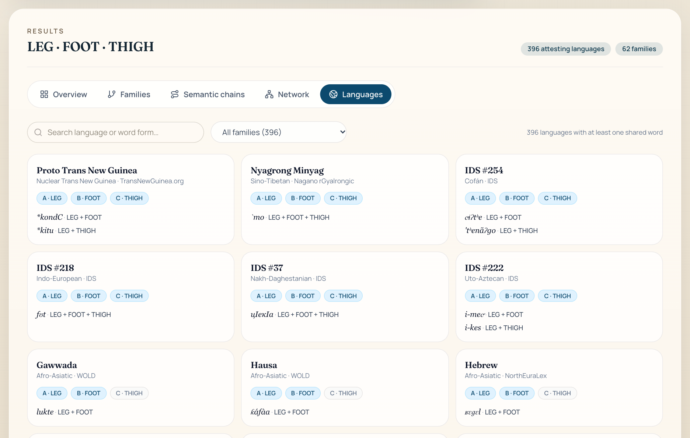

# Cross-Linguistic Concept Comparator

Compare how the world's languages group concepts into words.

Pick 2–6 concepts (HAND, ARM, FINGER…) and the app shows which languages use **one word for several of them** (*colexification*), how that varies across language families, the actual word forms, and the **indirect semantic chains** that link concepts never colexified directly. It uses the [CLICS³](https://clics.clld.org/) network: 2,681 languages in 180 families.



## Features

| | |
|---|---|
| **Overview** | Matrix of how many languages colexify each pair, plus a *neighbourhood similarity* score per pair (cosine of Node2Vec embeddings of the CLICS graph) that captures relatedness even without a shared word. |
| **Families** | Attesting languages per family for a pair, as counts and as a share of the family. |
| **Semantic chains** | Indirect paths such as WIND → AIR → BREATH → SOUL, where each step is an attested colexification, ranked by strength, for all of CLICS or a single family. |
| **Network** | Interactive force layout of the concepts in their CLICS neighbourhood, filterable by family. |
| **Languages** | Every attesting language with the concepts it merges and the **attested word form** (e.g. Czech *noɦa* = LEG + FOOT), searchable by language or form. |
| **Study links & history** | Every study is a shareable URL (`?concepts=1277,1673&tab=chains`), and past studies are kept locally. |

Concepts are pinned to [Concepticon](https://concepticon.clld.org/) IDs, so "DAY" means *DAY (NOT NIGHT)* and not *DAY (24 HOURS)*.

## Screenshots

<table>
  <tr>
    <td width="50%"><br><sub><b>Semantic chains:</b> WIND and SOUL never share a word, but are linked through AIR and BREATH.</sub></td>
    <td width="50%"><br><sub><b>Families:</b> HAND = ARM in 294 languages across 48 families.</sub></td>
  </tr>
  <tr>
    <td width="50%"><br><sub><b>Network:</b> TREE · WOOD · FIREWOOD · FIRE in the CLICS graph.</sub></td>
    <td width="50%"><br><sub><b>Languages:</b> the attested forms behind each colexification.</sub></td>
  </tr>
</table>

## How it works

```
frontend (React + Vite + Tailwind + Recharts)
   │  REST + server-sent events for study progress
   ▼
backend (FastAPI)
   ├─ ClicsService            loads the CLICS³ network (networkx), chain search
   ├─ ColexificationService   per-pair evidence, family profiles, word forms
   ├─ ConceptRegistryService  Concepticon registry + Node2Vec embeddings (atlas.sqlite)
   ├─ LanguageMetadataService readable language names for CLICS ids
   └─ StudyPipelineService    orchestrates a study and streams progress
```

**Semantic chains** enumerate all paths of 2–4 links between two concepts that avoid the direct edge, using only links attested in the chosen sample. A link's strength is the share of sampled languages that colexify it, and a chain's score is the geometric mean of its links, so one weak link pulls a chain down.

## Getting started

Requirements: Python 3.10–3.11, Node 18+.

### 1. Data

Put the CLICS files from this repository's [releases](https://github.com/TimeTravelerTy/cross-linguistic-analysis/releases) in `concept-comparator/backend/data/clics/`:

- `network-3-families.gml` (required)
- `clics.sqlite` (optional; provides language names. Without it some languages appear as e.g. *IDS #218*)

Then build the concept registry and embeddings (`atlas.sqlite`) once:

```bash
cd concept-comparator/backend
python3 -m venv .venv && source .venv/bin/activate
pip install -r requirements.txt
python scripts/run_ingestion.py --skip-omw
```

### 2. Backend

```bash
cd concept-comparator/backend
source .venv/bin/activate
python run.py
```

The API runs on `http://localhost:8000` (interactive docs at `/docs`). Set `PORT` to change it. See `backend/.env.example` for optional settings.

### 3. Frontend

```bash
cd concept-comparator/frontend
npm install
npm run dev
```

Open `http://localhost:5173`. If the backend is not on port 8000, create `frontend/.env.local` with `VITE_API_URL=http://localhost:<port>`.

## API

| Endpoint | Description |
|---|---|
| `GET /concepts?q=hand` | Search Concepticon (CLICS-linked and frequent concepts first) |
| `GET /concepts/by-id?ids=1277,1673` | Resolve Concepticon IDs |
| `POST /study-progress` | Run a study; streams progress and the result as SSE |
| `GET /chains?a=960&b=811&family=&max_depth=3` | Indirect semantic chains between two concepts |
| `GET /semantic-map?concepts=1277,1673` | CLICS neighbourhood graph |
| `GET /families` | Language families with language counts |

## Data and credits

- **CLICS³**: Rzymski, Tresoldi et al. (2020). *The Database of Cross-Linguistic Colexifications, reproducible analysis of cross-linguistic polysemies.* Scientific Data 7, 13.
- **Concepticon 3.4**: List et al. *Concepticon: A resource for the linking of concept lists.*
- Language families follow Glottolog.

## License

MIT, see [LICENSE](LICENSE).
